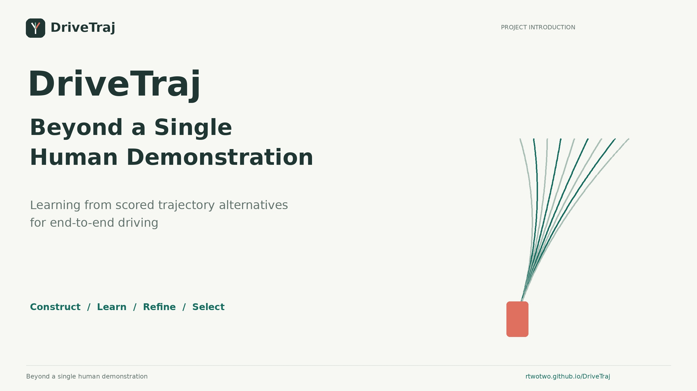
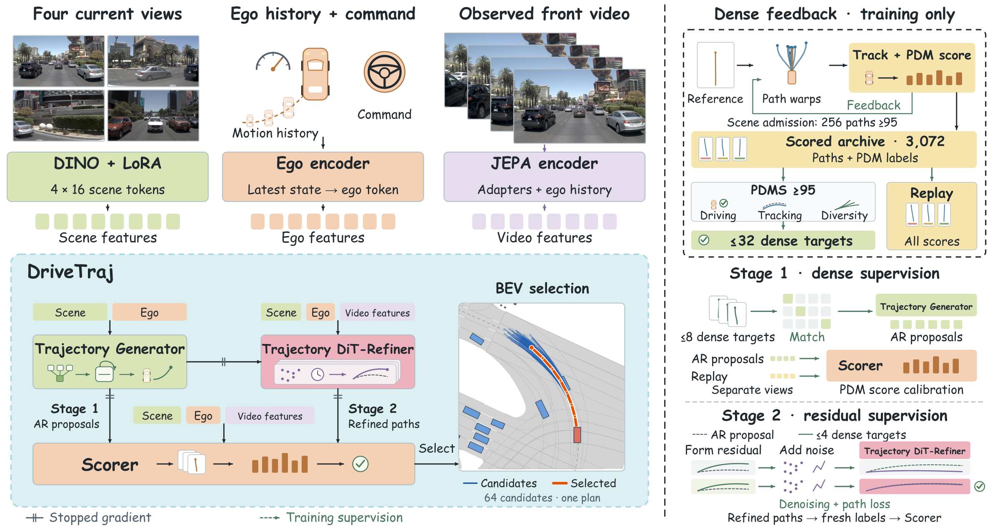

<p align="center"></p>
<h1 align="center">DriveTraj</h1>
<h3 align="center">Beyond a Single Human Demonstration:<br>Learning from Scored Trajectory Alternatives for End-to-End Driving</h3>
<p align="center"><a href="https://rtwotwo.github.io/DriveTraj/">Project page</a> · <a href="https://rtwotwo.github.io/DriveTraj/#film">Demo video</a> · <a href="https://rtwotwo.github.io/DriveTraj/#navtest">NAVTEST gallery</a> · <a href="https://rtwotwo.github.io/DriveTraj/#hugsim">HUGSIM gallery</a></p>

[](https://rtwotwo.github.io/DriveTraj/#film)

**One recorded drive can teach more than one plan.** DriveTraj constructs scored trajectory alternatives from driving logs, uses screened targets to supervise generation and residual correction, and trains a scorer to select among the resulting candidates.

This repository contains the project website, method figures, result summaries, and demonstration videos. Training code and model checkpoints are not included in this presentation release.

## Method



1. **Construct scored alternatives.** Search smooth deformations of a reference path and score their tracked execution. Driving validity, trackability, and geometric separation yield **2.61M targets from 103.3k real scenes**. Failed paths remain in the scoring archive.
2. **Stage 1: generate and score.** Dense one-to-one matching assigns targets to distinct autoregressive proposals alongside expert supervision. Scoring losses fit component labels and total scores on both native candidates and stratified replay.
3. **Stage 2: refine and select.** A residual diffusion transformer uses up to four compatible targets per parent. Denoising and trajectory losses share the same winner. Refined candidates receive fresh evaluator labels for scorer training.
4. **Adapt observed-video features.** A pretrained Joint-Embedding Predictive Architecture (JEPA) encoder learns from a masked-video objective. Separate adapters condition refinement and scoring. Only video loss updates JEPA; planning uses detached observed-frame features. Future training video is absent at inference.

## Results

Scores are on a 0–100 scale. NAVTEST evaluates 12.1k scenes; HUGSIM evaluates all 345 scenarios. Base uses 103.3k real training scenes; Scale uses 232.7k real and synthetic scenes.

| Model | Stage | NAVTEST PDMS ↑ | HUGSIM RC ↑ | HUGSIM HD-Score ↑ |
|---|---:|---:|---:|---:|
| DriveTraj | 1 | 94.76 | 51.88 | 36.88 |
| DriveTraj | 2 | 95.14 | 55.22 | 44.05 |
| DriveTraj-Scale | 1 | 95.09 | 54.05 | 43.97 |
| **DriveTraj-Scale** | **2** | **95.55** | **56.09** | **46.69** |

PDMS is Predictive Driver Model Score; RC is route completion. The current Base core recipe omits the explicit pairwise Rank loss; the displayed Scale checkpoint retains it.

Extended Predictive Driver Model Score (EPDMS) results below use **Stage 1**, with benchmark-specific selection settings:

| Model | NAVTEST EPDMS ↑ | NAVHARD EPDMS ↑ |
|---|---:|---:|
| DriveTraj | 91.15 | 50.80 |
| DriveTraj-Scale | 91.32 | 56.13 |

[Machine-readable results](docs/assets/data/results.json)

## Video demonstrations

### NAVTEST: 41 selected comparisons

The [interactive gallery](https://rtwotwo.github.io/DriveTraj/#navtest) preserves the **1 × 5 layout**: front-view projections, DriveTraj, FPD-Drive, Chainflow, and DrivoR. Every predicted waypoint has a vehicle footprint. Collision and off-road events use evaluator timestamps. Projections are recomputed with each recorded-camera update.

These animations show **fixed-start plans**, not per-frame model replanning. All 41 qualifying cases are included: DriveTraj ≥95 PDMS and all three baselines <80. The full reproduced NAVTEST means are DriveTraj 95.55, FPD-Drive-Pro 95.69, ChainFlow-VLA 94.85, and DrivoR 94.58.

[41-case manifest](docs/assets/data/navtest-cases.json) · [All paired scores](docs/assets/data/navtest-scores.csv) · [Original MP4 files](docs/assets/videos/navtest)

### HUGSIM: closed-loop driving

The [closed-loop gallery](https://rtwotwo.github.io/DriveTraj/#hugsim) uses the **95.55 DriveTraj-Scale Stage 2 checkpoint**. It selects the highest-HD episode from each of KITTI-360, nuScenes, PandaSet, and Waymo. The full-suite means remain **RC 56.09 / HD-Score 46.69** across 345 scenarios.

Gallery videos retain full episode timing and show the three front-camera views. The branded introduction uses 10-second excerpts. Native scorer coefficients are `1 / 1 / 0 / 5 / 5 / 2` in `NC / DAC / DDC / TTC / progress / comfort` order.

[Selected episodes](docs/assets/hugsim-selection.json) · [All 345 scores](docs/assets/data/hugsim-scores.csv) · [Download the introduction MP4](https://rtwotwo.github.io/DriveTraj/assets/videos/drivetraj-demo.mp4)

## Preview and publish

```bash
python tools/check_site.py
python -m http.server 8000 --directory docs
```

Open `http://localhost:8000`. The site uses plain HTML, CSS, and JavaScript; no build tool is required. GitHub Pages deploys `docs/` through the included workflow. In repository **Settings → Pages**, select **GitHub Actions** as the source.

## Acknowledgments

Evaluation and visualization build on NAVSIM and HUGSIM. The comparison gallery includes predictions from FPD-Drive-Pro, ChainFlow-VLA, and DrivoR. Page and demonstration organization follows our related [DriveTTO project](https://rtwotwo.github.io/DriveTTO/). Dataset imagery and third-party model outputs remain subject to their respective source terms.
